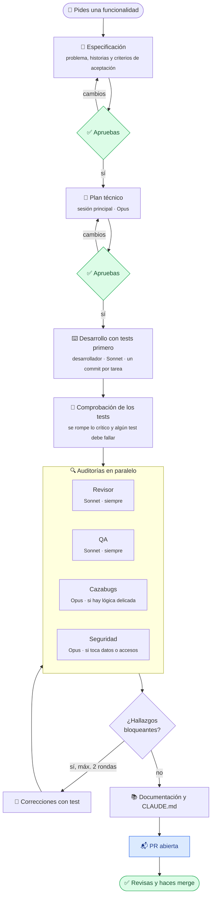

<div align="center">

# 🛠️ Taller Dev

**Proyectos profesionales desde el primer commit y un equipo de desarrollo completo en cada funcionalidad.**

Tres plugins de Claude Code: uno arranca o adapta proyectos con el estándar, otro especifica, planifica, desarrolla y audita cada cambio antes de que llegue a tu revisión, y un panel te enseña en todo momento qué hace cada agente y cuánto te queda de tu plan.


[Qué incluye](#-qué-incluye) · [Cómo funciona](#-cómo-funciona) · [Instalación](#-instalación) · [Uso](#-uso) · [El equipo](#-el-equipo) · [Panel](#-panel) · [Documentación](#-documentación) · [Protecciones](#-protecciones) · [Mantenimiento](#-mantenimiento)

</div>

---

## ✨ Qué incluye

<table>
<tr>
<td width="33%" valign="top">

### 🚀 `arranque`

Activo en todo el Mac. Prepara proyectos.

- **`/arranque:nuevo-proyecto`**: descubrimiento, plan de stack y arquitectura que apruebas tú, y proyecto creado con todo en su sitio.
- **`/arranque:adaptar-proyecto`**: diagnóstico de un proyecto existente y PR que lo lleva al estándar sin romper nada.
- **`/arranque:actualizar-proyecto`**: lleva a un proyecto que ya sigue el estándar las novedades de las plantillas, solo lo que falta y con tu aprobación.

</td>
<td width="33%" valign="top">

### 👥 `equipo`

Activo solo en tus proyectos. Hace el trabajo.

- **`/equipo:funcionalidad`**: especificación, plan, desarrollo con tests y auditorías según el riesgo de cada cambio antes de abrir la PR.
- **`/equipo:arreglo`**: causa raíz, test que reproduce el bug, corrección mínima y auditorías proporcionales.

</td>
<td width="33%" valign="top">

### 📊 `panel`

Activo en todo el Mac. Te enseña lo que pasa.

- **Franja** siempre visible: uso del plan, coste y agente activo.
- **`/panel`**: agentes, tokens y coste por agente, mes y cronología.
- **`/panel-resumen`**: resumen redactado de la sesión.

</td>
</tr>
</table>

No hace falta escribir los comandos: el `CLAUDE.md` de cada proyecto indica que toda funcionalidad o bug pasa por su flujo, así que basta con pedirlo con tus palabras.

## 🔄 Cómo funciona

Cada funcionalidad sigue el mismo camino. Tú decides en tres puntos; el resto es automático.



Para cambios pequeños hay un **modo ligero**: especificación breve, una sola aprobación y solo control de calidad (más seguridad si toca entradas o datos). El flujo lo propone y tú lo confirmas.

### Especificación primero (SDD)

Cada funcionalidad deja su rastro en el repositorio, como documentación normal del proyecto:

```text
docs/specs/007-firma-de-partes/
├── spec.md    Qué y por qué: historias de usuario y criterios de aceptación verificables
├── plan.md    Cómo: código que se reutiliza, datos, contratos, errores, seguridad y pruebas
└── tasks.md   Tareas ordenadas; cada una es un commit con su test
```

Los principios del proyecto viven en `docs/ARCHITECTURE.md` y toda especificación y plan se contrastan con ellos.

## 📦 Instalación

Requisitos: macOS con [Homebrew](https://brew.sh), `git`, [`mise`](https://mise.jdx.dev), `jq`, `gh` o `glab` autenticado y Claude Code 2.1.295 o posterior.

```bash
# 1. Registra el catálogo (una vez por Mac; usa tu sesión de gh)
claude plugin marketplace add davidgarcia11/taller-dev

# 2. Instala arranque y panel en todo el Mac
claude plugin install arranque@taller-dev
claude plugin install panel@taller-dev

# 3. Comprueba
claude plugin list
```

El plugin `equipo` no se instala a mano: `nuevo-proyecto` y `adaptar-proyecto` lo activan en cada proyecto con `--scope local`, que queda en `.claude/settings.local.json` y nunca se sube a git.

> [!TIP]
> Si ya tenías la skill `nuevo-proyecto` guardada en claude.ai, desactívala allí para que no haya dos versiones. Bórrala cuando hayas creado un par de proyectos con el plugin sin problemas.

## 🧭 Uso

### Crear un proyecto

```text
Quiero crear una app para gestionar los partes de obra desde el móvil
```

O directamente `/arranque:nuevo-proyecto`. Te preguntará lo necesario y te presentará un plan razonado:

- **Stack** elegido con criterios eliminatorios (madurez, soporte, seguridad, tipado, coste, ecosistema) y verificado en vivo: versión estable, fin de soporte, mantenimiento, vulnerabilidades y licencia. Prioriza lo que ya dominas.
- **Arquitectura** con las decisiones escritas: módulos por dominio, datos y migraciones, errores, observabilidad, contratos, concurrencia, ficheros e interfaz.
- **Seguridad desde el diseño**: modelo de amenazas, autenticación y autorización, RGPD, secretos, dependencias y cabeceras.

Cuando lo apruebes, creará el proyecto, el repositorio privado y lo dejará listo con:

- Herramientas fijadas por proyecto en `mise.toml`. Nada global.
- Hooks de git: secretos bloqueados, conventional commits obligatorios y autoría limpia.
- CI en GitHub Actions o GitLab CI que ejecuta exactamente `mise run check`.
- Plantilla de PR/MR, Dependabot (GitHub), `docs/` con arquitectura, ADR y especificaciones, y CHANGELOG generado desde los commits.
- Servicios locales con Colima y `compose.yaml` si el proyecto los necesita.
- Seguridad presente desde el primer commit: cabeceras, validación de configuración, autenticación de librería y alertas de Dependabot activadas.
- `CLAUDE.md`, reglas por zona del código en `.claude/rules/`, permisos, hooks y el equipo, activados solo en local.

### Adaptar un proyecto existente

```text
/arranque:adaptar-proyecto ~/Projects/erp-encofrados
```

Hace un diagnóstico de solo lectura (stack, hooks, CI, secretos en el historial, dependencias vulnerables, archivos del asistente rastreados), te propone los cambios y, con tu aprobación, los aplica en la rama `chore/adaptar-estandar` con su PR.

### Trabajar en un proyecto

```text
Añade la firma de partes desde el móvil con el DNI del trabajador
```

```text
Al exportar el parte en PDF salen mal las horas extra de los sábados
```

La primera petición arranca `/equipo:funcionalidad` y la segunda `/equipo:arreglo`. Al final tienes una PR con la especificación enlazada, todos los checks en verde y el resumen de cada auditoría.

## 👥 El equipo

| Rol | Modelo | Qué hace | ¿Modifica código? |
|---|:---:|---|:---:|
| 🧭 **jefe técnico** (sesión principal) | Opus | Especifica contigo, planifica con la skill `diseno-tecnico`, coordina a los agentes y abre la PR | Solo documentos |
| ⌨️ **desarrollador** | Sonnet | Implementa con tests primero, un commit por tarea, y corrige los hallazgos | ✅ |
| 🔎 **revisor** | Sonnet | Código limpio, duplicación, simplicidad, tests y cumplimiento del plan | ❌ |
| 🧪 **qa** | Sonnet | Check completo, matriz de criterios, cobertura de lo cambiado, tests intermitentes, build y migraciones | ❌ |
| 🐛 **cazabugs** | Opus | Límites, entradas inválidas, estados, concurrencia y fallos externos; cada bug con su test | ❌ |
| 🛡️ **seguridad** | Opus | OWASP Top 10 2025, ASVS, secretos, dependencias y RGPD | ❌ |

**Por qué estos modelos.** Opus donde un fallo de criterio sale caro: diseñar la funcionalidad, imaginar cómo se rompe y pensar como un atacante. Sonnet donde el método está escrito en su skill: implementar, revisar el código y ejecutar comprobaciones.

**Qué auditores entran.** QA y revisor, siempre. Seguridad, si el cambio toca accesos, datos personales, pagos, secretos, dependencias o entradas de usuario. Cazabugs, si hay estados, cálculos, concurrencia, integraciones o migraciones. Antes de lanzarlos te dice cuáles van y por qué, y puedes pedir los que falten. Así una pantalla sencilla no gasta lo mismo que un pago.

**Por qué el plan lo hace la sesión principal.** Es quien ha hablado contigo y conoce los matices de la especificación. Un agente aparte empezaría solo con `spec.md`. El plan se escribe para que baste por sí solo, porque el desarrollador trabaja únicamente con los documentos.

**Por qué un solo agente escribe código.** Varios agentes escribiendo a la vez toman decisiones implícitas que chocan entre sí. Con un único escritor y revisores independientes, cada cambio es coherente y se verifica desde fuera.

**Por qué los auditores no corrigen.** Quien encuentra un fallo no lo arregla, igual que en un equipo real. Así sus informes son independientes y pueden trabajar a la vez sin pisarse.

Cada agente carga al empezar su skill de conocimiento (`codigo-limpio`, `revision-codigo`, `control-calidad`, `caza-de-bugs` y `auditoria-seguridad`), con su método, su escala de gravedad y el formato de su informe. La sesión principal carga `diseno-tecnico` al planificar.

### Gravedad de los hallazgos

| Gravedad | Qué pasa |
|---|---|
| 🔴 **Crítico** | Bloquea. Se corrige siempre. |
| 🟠 **Alto** | Bloquea. Se corrige siempre. |
| 🟡 **Medio** | Se corrige salvo que decidas aplazarlo. |
| ⚪ **Bajo** | Se anota en la PR como pendiente. |

## 📊 Panel

Un mod de Claude Code que dibuja dos cosas: una franja fija sobre el cuadro de texto y un panel completo que abres con `/panel` o con su botón.

```text
5 h 52 % (2 h 10 min) · semana 21 % · sesión 10,80 $ · ● desarrollador: edita partes.ts   [ Panel ]
```

```text
TU PLAN
5 horas █████████░░░░░░░░  52 %  se renueva en 2 h 10 min
Semana  ███░░░░░░░░░░░░░░  21 %  se renueva en 1 d 20 h

AHORA
● desarrollador  Sonnet · edita partes.ts
● qa             Sonnet · ejecuta mise run check
✓ seguridad      Opus · terminado

CONSUMO DE LA SESIÓN
                  Modelo    Entrada   Salida     API $
sesión principal  Opus       1,24 M   38,2 k    4,10 $
desarrollador     Sonnet     2,06 M   51,7 k    2,92 $
seguridad         Opus       0,41 M   12,9 k    1,62 $
Total                        4,98 M  131,4 k   10,80 $
Este mes en Claude Code: 143,20 $ · mes anterior: 98,10 $

RESUMEN                [ Redactar con Haiku ]
12:03  Tú: añade la firma de partes desde el móvil
12:20  Lanza desarrollador: Implementa T1-T3
12:41  seguridad termina (4 min) · CAMBIOS NECESARIOS
12:58  PR abierta: https://github.com/…/pull/14
```

| Dato | De dónde sale | Precisión |
|---|---|---|
| % de las 5 horas y semanal, y cuándo se renuevan | Lo que Anthropic envía a Claude Code tras cada respuesta. Incluye el chat y otros proyectos, porque comparten cupo | Exacto, actualizado en la siguiente respuesta |
| Qué hace cada agente | Cada herramienta que usa, con su agente | Exacto, en tiempo real |
| Tokens de entrada y salida por agente | Cada petición al modelo | Exacto. La entrada incluye los tokens leídos de caché |
| Coste por agente | Tokens × precios oficiales de la API | Exacto según la tabla de precios (la escritura en caché se cuenta a la tarifa de 5 minutos) |
| Coste de la sesión | El mismo total que `/cost` | Exacto |
| Coste del mes | Suma de las sesiones de Claude Code con el panel activo | Exacto para Claude Code; el chat no expone su consumo |

Los dólares son lo que costaría por API: con tu suscripción no los pagas. Sirven para decidir si algún día te compensaría la API. Avisa con una notificación al llegar al 80 % y al 95 % de tu límite de 5 horas, y al 90 % del semanal.

Necesita Claude Code 2.1.287 o posterior. Se dibuja en la terminal y en la pestaña Code de la app de escritorio; en el chat de la extensión de VS Code no se ve.

## 📚 Documentación

Cada proyecto se documenta mientras se programa, no al final. El plan de cada funcionalidad dice qué documentos cambian y cada tarea los actualiza en su propio commit; el revisor lo comprueba.

| Documento | Qué recoge | Cuándo se actualiza |
|---|---|---|
| `README.md` | Qué es, requisitos, arranque y comandos | Al cambiar comandos o configuración |
| `docs/ARCHITECTURE.md` | Visión, principios, stack, estructura, operación y mapa de la documentación | Al cambiar estructura o stack |
| `docs/adr/` | Decisiones con sus alternativas | En cada decisión relevante |
| `docs/specs/NNN/` | Especificación, plan y tareas | En cada funcionalidad |
| Comentarios en el código | API pública: qué hace, parámetros, errores y ejemplos | En el mismo commit que la cambia |
| `docs/api/openapi.json` | Referencia de la API, generada desde el código | Al cambiar un contrato; el check falla si no coincide |
| `docs/RUNBOOK.md` | Despliegue, vuelta atrás, copias, secretos, alertas e incidencias | Al cambiar la operación |
| `CHANGELOG.md` | Cambios por versión, en castellano | Se genera de los commits con `mise run version` |
| PR | Qué, por qué, cómo probarlo y resultado de las auditorías | En cada cambio |

La referencia OpenAPI solo existe en proyectos con API, y el runbook en proyectos con despliegue. Para bugs graves en producción, el flujo propone un informe de incidencia en `docs/incidencias/`.

## 🔒 Protecciones

Las instrucciones guían; estas protecciones obligan, aunque alguien se las salte.

| Protección | Cómo | Dónde |
|---|---|---|
| Sin secretos en git | `gitleaks` en pre-commit y en CI sobre todo el historial | Hook de git y CI |
| Dependencias sin vulnerabilidades conocidas | `osv-scanner` dentro de `mise run check` | Local y CI |
| Commits con formato | conventional commits obligatorios, primera línea de 100 caracteres como máximo | Hook `commit-msg` |
| Autoría limpia | elimina `Co-Authored-By`, enlaces de sesión y «Generated with» | Hook `commit-msg` y ajustes de atribución |
| Sin commits en `main` | el hook bloquea el commit y obliga a crear rama | Hook de Claude Code |
| Sin atajos peligrosos | prohibidos force push, `--no-verify`, merge y `npm -g` | Permisos de Claude Code |
| Nada se integra roto | CI ejecuta el mismo `mise run check` que en local | GitHub Actions o GitLab CI |
| El merge es tuyo | ningún flujo hace merge | Permisos y flujos |

## 🗂️ Qué queda en cada proyecto

```text
mi-proyecto/
├── .githooks/                pre-commit y commit-msg          ┐
├── .github/ o .gitlab/       CI y plantilla de PR/MR          │
├── docs/                                                      │
│   ├── ARCHITECTURE.md       visión, principios y operación   │ En git
│   ├── adr/                  decisiones                       │
│   └── specs/                una carpeta por funcionalidad    │
├── compose.yaml              servicios locales (si los hay)   │
├── cliff.toml · CHANGELOG.md  cambios por versión             │
├── mise.toml                 herramientas y tareas            ┘
│
├── CLAUDE.md                 reglas generales del proyecto    ┐
├── .claude/                  reglas por zona, permisos, hooks │ Solo en tu Mac
└── .worktreeinclude          copia lo anterior a worktrees    ┘
```

Lo local se excluye en `.git/info/exclude`, así que no aparece en `git status` ni llega nunca al repositorio. Los worktrees que crea Claude Code reciben esos archivos gracias a `.worktreeinclude`.

## 🌳 Con Orca

[Orca](https://www.onorca.dev) abre cada tarea en un worktree propio con su agente. Los plugins funcionan igual porque Orca usa tu `~/.claude`.

**Proyecto nuevo**

1. En Orca: **Agregar proyecto → Crear nuevo proyecto**, dentro de `~/Projects`.
2. Abre el agente **Claude** en la fila principal del proyecto (`main`), no en una tarea nueva: el proyecto se crea en la copia principal.
3. Ejecuta `/arranque:nuevo-proyecto`: detecta el repo recién creado y trabaja en él.

**Ajustes del repositorio en Orca** (una vez por proyecto)

| Ajuste | Valor |
|---|---|
| Rama base | `origin/main` |
| Hook de preparación | `mise trust && mise install && mise run setup` |
| Agente | Claude (no Agent Teams) |
| Modo Yolo | desactivado |

**Cómo se adapta el flujo**

- Cada worktree recibe `CLAUDE.md`, `.claude/` y `.env` gracias a `.worktreeinclude`.
- Dentro de un worktree, `/equipo:funcionalidad` y `/equipo:arreglo` no cambian a `main`: renombran la rama del worktree a `feat/NNN-…` o `fix/…` sobre `origin/main`.
- El número de especificación mira también las ramas de los demás worktrees, así que dos funcionalidades en paralelo no chocan.
- El merge lo sigues haciendo tú desde la PR.

## 🔧 Mantenimiento

### Actualizar

1. Cambia lo que quieras en este repositorio.
2. Sube la versión en el `plugin.json` afectado y en `.claude-plugin/marketplace.json`, y anótalo en el [CHANGELOG](CHANGELOG.md).
3. Haz push y actualiza en el Mac:

```bash
claude plugin marketplace update taller-dev
claude plugin update arranque@taller-dev
claude plugin update equipo@taller-dev
claude plugin update panel@taller-dev
```

4. En cada proyecto, si la versión trae plantillas nuevas (lo dice el CHANGELOG), ejecuta `/arranque:actualizar-proyecto`. El comportamiento del equipo se actualiza solo; las reglas, hooks y documentos del proyecto, con este comando.

### Desinstalar

```bash
claude plugin uninstall arranque@taller-dev
claude plugin uninstall panel@taller-dev
claude plugin marketplace remove taller-dev   # también quita equipo de todos los proyectos
```

### Coste de contexto

| Plugin | Siempre cargado | Al usarse |
|---|---|---|
| `arranque` | ~330 tokens, en todas las sesiones | ~2-5k por skill |
| `equipo` | ~860 tokens, solo en tus proyectos | ~1-3k por skill o agente |
| `panel` | 0: no añade instrucciones a Claude | céntimos por cada `/panel-resumen` |

Medido con `claude plugin details <plugin>@taller-dev`.

## 🏗️ Estructura del repositorio

```text
taller-dev/
├── .claude-plugin/marketplace.json     Catálogo con los tres plugins
├── plugins/
│   ├── arranque/
│   │   ├── bin/taller-base             Aplica la base sin sobrescribir nada
│   │   ├── plantillas/                 Hooks, CI, docs, runbook, CHANGELOG, CLAUDE.md, settings, compose y tareas
│   │   └── skills/                     nuevo-proyecto (+ stack, arquitectura, seguridad) · adaptar-proyecto · actualizar-proyecto
│   ├── equipo/
│   │   ├── agents/                     desarrollador · revisor · qa · cazabugs · seguridad
│   │   ├── plantillas/                 spec.md · plan.md · tasks.md
│   │   └── skills/                     funcionalidad · arreglo · 6 skills de conocimiento
│   └── panel/
│       ├── hooks/                      register.tsx (franja, panel y eventos) · logica.ts (precios y formato)
│       ├── types/                      contrato del estado del panel
│       └── tests/                      pruebas automáticas del mod
├── tests/probar-base.sh                Pruebas del script y los hooks
└── .github/workflows/validar.yml       Validación en cada push
```

### Validar en local

```bash
claude plugin validate --strict .
claude plugin validate --strict plugins/arranque
claude plugin validate --strict plugins/equipo
claude plugin validate --strict plugins/panel
claude plugin test plugins/panel
bash tests/probar-base.sh
```

Para probar cambios sin instalar: `claude --plugin-dir plugins/equipo`.

---

<div align="center">
<sub>Hecho para trabajar con calma: plan antes que código, tests antes que implementación y tu revisión antes que el merge.</sub>
</div>
