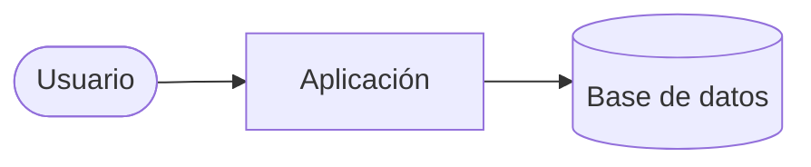

# Arquitectura de NOMBRE

> Documento vivo. Se actualiza en la misma PR que cambie la estructura, el stack o un principio.

## 1. Visión

<!-- Qué problema resuelve, para quién y qué entra en la v1. -->

**Fuera de alcance:**

-

## 2. Principios

Reglas no negociables del proyecto. Toda especificación y todo plan deben cumplirlas; cambiarlas requiere un ADR.

1. **Simplicidad primero.** La solución mínima que cumple la especificación. Sin abstracciones especulativas.
2. **Reutilizar antes que crear.** Se busca código existente antes de escribir uno nuevo.
3. **Tests primero.** Cada criterio de aceptación tiene al menos un test que lo demuestra.
4. **Validar en los bordes.** Toda entrada externa se valida con esquema; la configuración se valida al arrancar.
5. **Seguridad y privacidad por defecto.** Mínimo privilegio, mínimos datos personales, nada de secretos en el código.
6. <!-- Principios propios del dominio. -->

## 3. Stack

| Capa | Elección | Versión | Motivo |
|---|---|---|---|
| Runtime | | | |
| Framework | | | |
| Datos | | | |
| Autenticación | | | |
| Hosting | | | |
| Tests | | | |
| Lint y formato | | | |

Las versiones exactas están fijadas en `mise.toml` y en el gestor de dependencias.

## 4. Contexto y componentes



## 5. Estructura del código

```text
src/
```

<!-- Responsabilidad de cada carpeta y reglas de dependencia entre módulos. -->

## 6. Modelo de datos

<!-- Entidades principales, relaciones y restricciones. -->

## 7. Calidad

- `mise run check` ejecuta: <!-- lint, formato, tipos, tests, build, secretos, dependencias -->
- Niveles de test: unitarios en lógica de dominio, integración en endpoints y datos, extremo a extremo solo en flujos críticos.

## 8. Seguridad y privacidad

<!-- Autenticación, autorización, datos personales y su base legal, secretos, dependencias. -->

## 9. Operación

| Aspecto | Decisión |
|---|---|
| Entornos | |
| Despliegue | |
| Migraciones | |
| Copias de seguridad | |
| Logs y errores | |
| Secretos en producción | |

## 10. Decisiones

Registro en [`docs/adr/`](adr/). Cada decisión relevante tiene su ADR.

## 11. Mapa de la documentación

| Documento | Contenido |
|---|---|
| [`README.md`](../README.md) | Qué es, requisitos, arranque y comandos |
| Este documento | Visión, principios, stack, estructura y operación |
| [`docs/adr/`](adr/) | Decisiones y sus alternativas |
| [`docs/specs/`](specs/) | Una especificación, plan y tareas por funcionalidad |
| [`CHANGELOG.md`](../CHANGELOG.md) | Cambios por versión, generado desde los commits |
| <!-- `docs/api/openapi.json` --> | <!-- Referencia de la API, generada desde el código --> |
| <!-- `docs/RUNBOOK.md` --> | <!-- Despliegue, copias, incidencias y tareas periódicas --> |
